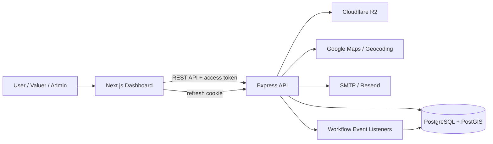
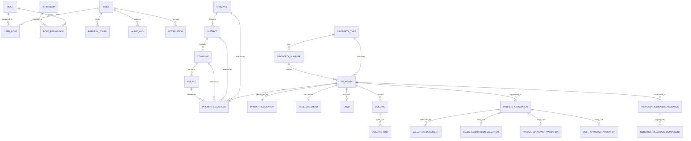

# CamTop Property Valuation

This workspace contains the backend API and the frontend dashboard used for property valuation, indicative valuation, authentication, role-based access, maps, and reporting.

## Projects

- `property_valution_api`
  Express + TypeScript + Prisma + PostgreSQL/PostGIS backend
- `property_valution_system`
  Next.js + React dashboard frontend

## Repository Structure

```text
.
├── property_valution_api
└── property_valution_system
```

## System Design

CamTop is designed as a two-application workspace:

- `property_valution_system` provides the browser-based dashboard for authentication, property operations, valuation workflows, reporting, and map interaction.
- `property_valution_api` provides the REST API, workflow rules, file handling, notifications, auditing, and database access.
- PostgreSQL stores transactional data, while PostGIS extends the database with spatial types and GIS indexes for property geometry and administrative boundaries.
- Optional integrations support map geocoding, object storage, and email delivery.



### Runtime Flow

1. Users access the frontend dashboard and authenticate through the API.
2. The frontend sends authenticated API requests and automatically refreshes expired sessions with a cookie-based refresh flow.
3. The API persists business data through Prisma into PostgreSQL/PostGIS.
4. Property, valuation, and indicative valuation workflows emit events that generate notifications for reviewers and valuers.
5. Supporting services handle geocoding, map links, document storage, and outbound email.

## Core Use Cases

### 1. Authentication and Access Control

- Register, log in, verify email, reset password, and refresh sessions.
- Assign roles and permissions for admins, reviewers, and valuers.
- Track account status, login attempts, and refresh tokens.

### 2. Property Intake and Review

- Create a property with type, subtype, current use, address, legal title, land/building details, and photos.
- Capture map coordinates, polygons, and GIS-linked address details.
- Submit the property for review, then approve or reject it with workflow status tracking and notifications.

### 3. Full Property Valuation

- Create a formal valuation record for a property.
- Support sales comparison, income approach, and cost approach methods.
- Attach comparable evidence, transactions, versioned valuation documents, notes, and approval metadata.

### 4. Indicative Valuation

- Produce a faster estimate using valuation components such as land and building ranges.
- Store min/max values, forced-sale values, workflow state, and generated PDF metadata.
- Route the estimate through review and approval with notifications.

### 5. Reporting, Notifications, and Auditability

- Generate reports for valuation, listings, audit activity, and user activity.
- Notify privileged reviewers when submissions enter the approval queue.
- Maintain audit logs for operational traceability and governance.

## Database Design

The backend schema is centered on workflow-driven property records. Prisma defines the relational model, and PostGIS adds geometry support for map and boundary data.

### Domain Areas

| Domain | Main Tables | Purpose |
| --- | --- | --- |
| Identity and access | `users`, `accounts`, `refresh_tokens`, `roles`, `permissions`, `user_roles`, `role_permissions`, `user_preferences` | Authentication, session management, RBAC, and user settings |
| Property master data | `properties`, `property_types`, `property_subtypes`, `current_uses`, `building_subtypes`, `data_sources` | Core property classification and source metadata |
| Address and GIS | `property_address`, `property_locations`, `provinces`, `districts`, `communes`, `villages` | Administrative hierarchy, geocoding, geometry, and spatial search |
| Physical asset details | `title_documents`, `property_photos`, `lands`, `agriculture_lands`, `building`, `building_units` | Legal title, photos, land attributes, and building/unit details |
| Formal valuation | `property_valuations`, `valuation_documents`, `sales_comparison_valuations`, `income_approach_valuations`, `cost_approach_valuations`, `transactions`, `comparable`, `valuation_comparables`, `comparable_adjustments` | Valuation methods, evidence, pricing, and calculation support |
| Indicative valuation | `property_indicative_valuations`, `indicative_valuation_components` | Quick estimate workflow with component-based value ranges |
| Governance and communication | `audit_logs`, `notifications`, `generated_reports` | Audit trail, notifications, and generated report history |

### Key Relationship Summary

- A `user` can hold many roles, refresh tokens, audit logs, notifications, and workflow assignments.
- A `property` belongs to one property type and can have one address, one location, one title document, one land record, and many buildings, transactions, valuations, and indicative valuations.
- A `property_valuation` belongs to one property and can have many documents plus optional method-specific records for sales comparison, income, and cost approaches.
- A `property_indicative_valuation` belongs to one property and aggregates many value components.
- Geographic tables form a strict hierarchy from province to district to commune to village, and `property_address` references that hierarchy.
- Spatial data is stored in PostGIS geometry columns such as `geom`, `geom_polygon`, and administrative boundary geometries with GiST indexes.

### Simplified ER View



## Quick Start

### 1. Start the API

Recommended local backend setup uses Docker:

```bash
cd property_valution_api
docker-compose -f docker-compose.dev.yml up --build
```

Default local URLs:

- API: `http://localhost:4000`
- Health check: `http://localhost:4000/healthz`
- PostgreSQL: `localhost:5432`
- pgAdmin: `http://localhost:5050`

### 2. Start the frontend

In a new terminal:

```bash
cd property_valution_system
npm install
npm run dev
```

Default frontend URL:

- App: `http://localhost:3000`

## Environment Notes

The frontend expects the backend API base URL from:

```env
NEXT_PUBLIC_API_URL=http://localhost:4000/api
```

The backend development Docker setup already runs on port `4000`, so this matches the frontend defaults.

## Project Documentation

Detailed setup, environment variables, and deployment notes are available in the project-specific READMEs:

- Backend setup and deployment: [property_valution_api/README.md](./property_valution_api/README.md)
- Frontend setup and development: [property_valution_system/README.md](./property_valution_system/README.md)
